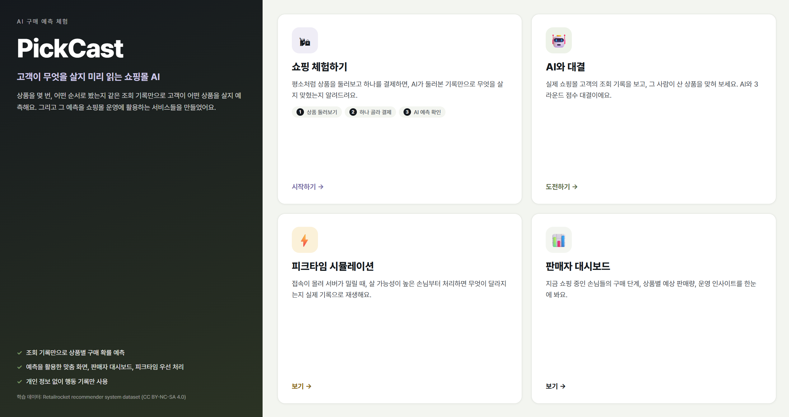
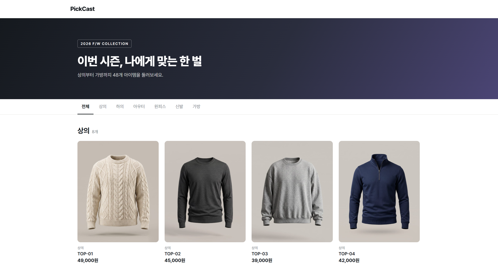
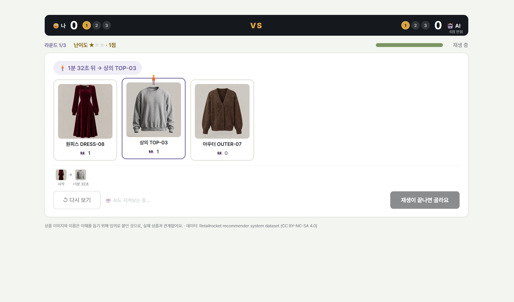
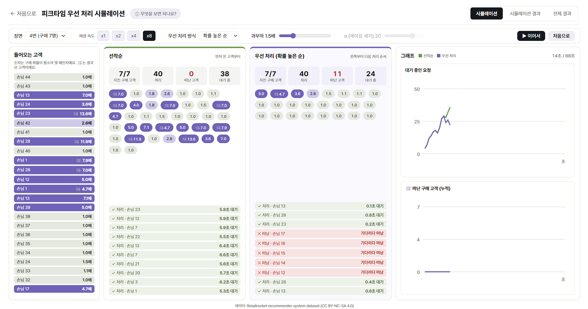
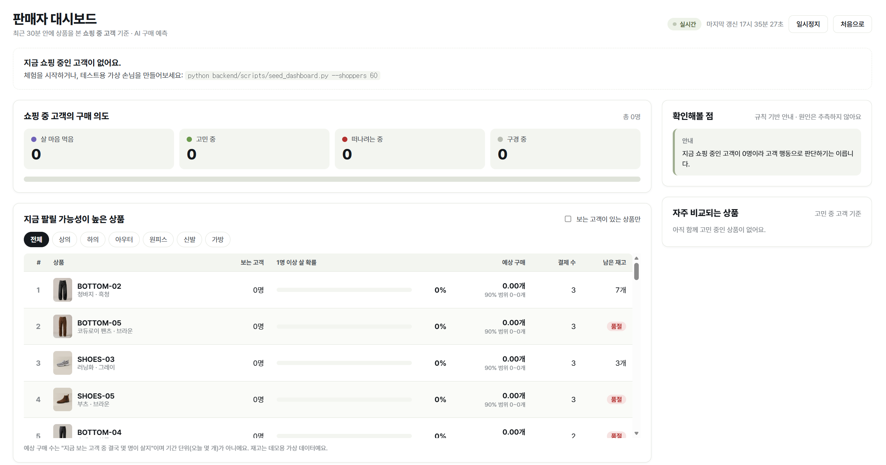
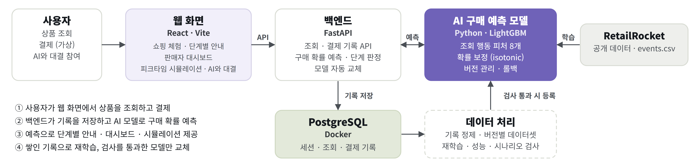
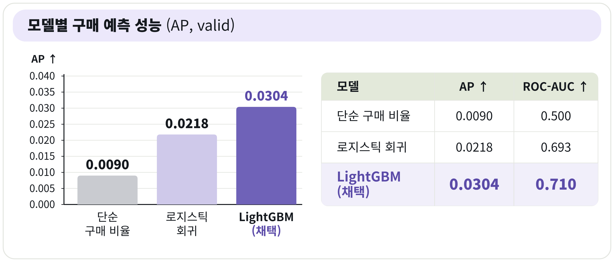

# PickCast

**고객이 무엇을 살지 미리 읽는 쇼핑몰 AI**

상품을 몇 번, 어떤 순서로, 얼마 만에 다시 봤는지 같은 **조회 기록만으로** 고객이 어떤 상품을 살지 확률로 예측하고, 그 예측을 쇼핑몰 운영에 쓰는 서비스 네 가지를 만들었습니다. 회원 정보나 상품 정보 없이 행동 기록만 씁니다.

캡스톤 팀 프로젝트 · 2026.09 ~ 2026.10 · AI학부 김해림 · 이화영 · 이선호



## 무엇을 체험할 수 있나

| 체험 | 내용 |
|---|---|
| **쇼핑 체험** | 48개 상품을 평소처럼 둘러보는 동안 구매 의도 단계를 판단해 비교·찜 안내를 띄우고, 결제하면 AI가 무엇을 살지 맞혔는지와 그 이유를 보여줍니다 |
| **AI와 대결** | 실제 쇼핑몰 고객의 조회 기록을 보고 그 사람이 산 상품을 사람과 AI가 각자 맞히는 3라운드 게임입니다. AI는 학습 때 본 적 없는 고객의 기록으로 맞힙니다 |
| **피크타임 우선 처리** | 접속이 몰려 서버가 밀릴 때, 살 가능성이 높은 고객부터 처리하면 선착순과 무엇이 달라지는지 실제 기록을 재생해 비교합니다 |
| **판매자 대시보드** | 지금 쇼핑 중인 고객들의 구매 의도 단계, 상품별 예상 판매량, 재고·이탈 같은 확인할 점을 5초마다 갱신합니다 |

| 쇼핑 체험 | AI와 대결 |
|---|---|
|  |  |
| **피크타임 우선 처리** | **판매자 대시보드** |
|  |  |

## 핵심 아이디어: 조회할 때마다 다시 계산하는 구매 확률

고객이 상품을 하나 볼 때마다, 지금까지 본 상품 **각각**이 앞으로 구매될 확률을 다시 계산합니다.

- **입력**: 그 시점까지의 조회 기록에서 계산한 피처 8개 (상품 조회 수, 전체 조회 중 비중, 첫·마지막 조회 후 경과 시간, 다른 상품을 보다가 돌아온 횟수, 전체 조회 수, 본 상품 수, 가장 최근에 본 상품인지)
- **정답**: 그 시점 이후 실제로 그 상품을 샀는지. 구매 기록은 정답을 만들 때만 쓰고 입력에는 넣지 않습니다
- **모델**: LightGBM. 나온 점수를 확률 보정(isotonic)해, 예측 확률이 실제 구매 비율과 맞게 만듭니다

확률은 "한 번만 본 상품의 확률(약 0.5%)보다 몇 배인지"로 바꿔 서비스 전체에서 같은 기준으로 씁니다. 단계 판단(대시보드의 단계별 인원 포함), 피크타임 우선순위, 게임의 AI 설명이 이 배수를 봅니다.

## 시스템 구성



- **ml**: 모델 학습·평가와 예측 계산. 모델 출력으로 하는 계산(확률, 단계, 예상 판매량)만 둡니다
- **backend**: API, DB, 업무 규칙(재고, 인사이트 문구, 세션 만료, 게임 채점)
- **frontend**: 체험 화면

## 모델 결과

학습 데이터는 RetailRocket 쇼핑몰 행동 로그(조회 266만 건, 구매 2.2만 건, 사용자 140만 명)입니다. 같은 사용자가 학습과 평가에 동시에 들어가지 않게 **사용자 단위로** train / valid / test = 70 / 15 / 15로 나눴습니다. 구매가 1% 미만인 데이터라 정확도 대신 AP(구매할 상품을 얼마나 위쪽 순위에 올리는지)로 비교했습니다.



- **test 한 번 평가**: 모델·보정·임계값을 valid에서 모두 정한 뒤 test를 한 번만 평가했고, 결과를 보고 다시 조정하지 않았습니다. AP 0.031로 단순 기준(0.009)의 약 3.4배입니다.
- **확률 보정**: 예측 2~3% 구간의 평균 예측 2.54%, 실제 구매 2.53%로 거의 일치합니다(v1, test). 지금 쓰는 v2는 같은 모델에 보정만 일반 고객 기준으로 다시 맞춘 버전이라, AP와 순위는 v1과 같습니다.
- **규칙보다 나은가**: 서비스 고객과 비슷한 일반 고객(조회 100회 미만)에서 "산 상품을 1순위로 고른 비율"은 모델 62.6%, 가장 많이 본 상품 58.9%, 가장 최근에 본 상품 50.2%입니다(test).

자세한 과정은 [모델 결과](docs/ml/product-purchase-model-results.md), [확장 기능 test 평가](docs/ml/extension-test-results.md)에 있습니다.

## 예측을 쓰는 서비스

### 구매 의도 단계 (쇼핑 체험)

조회할 때마다 구경 중 · 고민 중 · 살 마음 먹음 · 떠나려는 중을 판단합니다. 두세 상품을 오가면 비교 모달, 보던 상품에서 멀어지면 찜·가격 알림 모달을 띄웁니다.

기준값은 valid에서 확인했고, test에서도 단계별 이후 구매율이 구경 중 2.42% < 살 마음 먹음 3.96% < 고민 중 6.74% 순서로 재현됐습니다(v1 기준). 기획 때는 "살 마음 먹음"이 가장 높을 거라 봤지만, 실제로는 여러 상품을 비교하는 고객이 더 많이 샀습니다. 이 결과에 맞춰 단계의 해석을 바로잡았습니다. ([단계 판단 검증](docs/ml/stage-validation.md))

결과 화면의 예측은 **결제하러 들어간 마지막 조회 1개를 빼고** 계산합니다. 산 상품은 항상 마지막에 보게 되므로, 이 조회까지 넣으면 "방금 본 상품"이라는 이유만으로 맞히게 되기 때문입니다.

### 피크타임 우선 처리 시뮬레이션

test 기간에서 가장 붐빈 100개 시간대를 1시간 → 60초로 압축해 재생합니다. 서버는 들어오는 요청의 1/1.5만 처리하고, 10초 넘게 기다린 고객은 떠난다고 가정합니다.

| 방식 (test) | 지킨 구매 고객 | 확률 낮은 고객 이탈 |
|---|---:|---:|
| 선착순 | 57.1% (182명) | 14.1% |
| 확률 높은 순 | 82.1% (262명) | 45.5% |
| 에이징 α=20 | 62.7% (200명) | 17.4% |

확률 높은 순은 구매 고객을 가장 많이 지키지만 확률 낮은 고객이 크게 밀려납니다. 그래서 오래 기다린 요청의 순서를 올려 주는 에이징을 넣고, 세기(α)는 "확률 낮은 고객 이탈이 선착순보다 5%p 넘게 늘지 않는다"는 기준을 **결과를 보기 전에 정해** valid에서 골랐습니다. "처리만 되면 원래대로 샀을 것"이라는 가정 위의 시뮬레이션이라, 실제 효과는 A/B 테스트로 확인해야 합니다. ([피크타임 시뮬레이션](docs/ml/peak-simulation.md))

### AI와 대결

test 고객 중 "본 상품 2~6종류, 하루 안에 끝난 쇼핑" 기록 308개로 문제를 만들었습니다. 장바구니 기록은 정답을 거의 알려주므로 보여주지 않고, AI도 사람과 같은 조회 기록만 봅니다. 난이도는 AI 결과와 무관하게 정했습니다(산 상품이 혼자 가장 많이 본 상품인지, 본 상품이 4종류 이상인지).

| 난이도 | 문제 | AI 정답률 |
|---|---:|---:|
| ★ | 84 | 96.4% |
| ★★ | 165 | 53.3% |
| ★★★ | 59 | 30.5% |

## 재학습 파이프라인

체험 기록 내보내기 → 정제 → 버전별 데이터셋 → 재학습 → 검사 → 통과하면 등록 → 적용 / 롤백까지 한 흐름으로 만들었습니다.

- **검사**: 새 모델은 체험 평가 데이터에서 기존 모델보다 Log loss가 낮고 평균 예측이 실제 구매율에 더 가까워야 하며, 공개 데이터(RetailRocket)의 Log loss가 1% 넘게 나빠지지 않고, 손으로 만든 단계 판단 시나리오도 모두 통과해야 등록됩니다.
- **교체**: 모델은 `ml/models/`에 버전별로 두고 `current.json`이 지금 쓰는 버전을 가리킵니다. 백엔드는 5초마다 이 파일을 확인해 **재시작 없이** 새 버전으로 바꾸고, 문제가 있으면 이전 버전으로 되돌릴 수 있습니다.
- **첫 적용**: 일반 고객에게 확률이 높게 나오는 문제를 확인해 보정만 다시 맞춘 v2를 이 흐름으로 등록했고, 지금 서비스는 v2를 씁니다. ([v2 재보정](docs/ml/recalibration-v2.md))

## 기술 스택

| 영역 | 사용 기술 |
|---|---|
| 모델 | Python, LightGBM, pandas, scikit-learn |
| 백엔드 | FastAPI, SQLModel, PostgreSQL 17 (Docker) |
| 프론트엔드 | React 18, Vite, React Router |

## 직접 실행해 보기

Python, Node.js, Docker Desktop이 필요합니다. 명령은 모두 프로젝트 최상위 폴더(PowerShell)에서 실행합니다.

```powershell
# 1. DB
Copy-Item .env.example .env        # POSTGRES_PASSWORD와 DATABASE_URL의 비밀번호를 채움
docker compose up -d               # PostgreSQL (127.0.0.1:15432), Adminer (localhost:8080)

# 2. 백엔드 (모델 계산에 ml 패키지도 필요해서 두 requirements를 함께 설치)
python -m venv ml\.venv
ml\.venv\Scripts\python.exe -m pip install -r ml\requirements.txt -r backend\requirements.txt
ml\.venv\Scripts\python.exe -m uvicorn backend.app.main:app --reload    # http://127.0.0.1:8000/docs

# 3. 프론트엔드 (다른 터미널)
cd frontend
npm install
npm run dev                        # http://localhost:5173
```

- 서비스에 쓰는 모델(`ml/models/`)과 피크타임·게임 데이터(`ml/results/`)는 레포에 들어 있어서, RetailRocket 원본 없이도 모든 체험이 동작합니다.
- 판매자 대시보드를 채워 보려면 가상 손님을 만듭니다: `ml\.venv\Scripts\python.exe backend\scripts\seed_dashboard.py --shoppers 60`
- 모델을 직접 다시 학습하려면 RetailRocket의 `events.csv`가 필요합니다. 방법은 [ml/README](ml/README.md)에 있습니다.

## 프로젝트 구조

```
ml/
  product_purchase/   학습 데이터 생성, 학습·보정·평가, 예측(predict.py), 단계 판단(stage.py),
                      재학습 파이프라인, 피크타임 시뮬레이션, 게임 문제 생성
  models/             서비스에 쓰는 모델 버전 (current.json이 지금 버전을 가리킴)
  results/            백엔드가 읽는 피크타임 결과·재생 데이터, 게임 문제
backend/
  app/                API (세션·조회·결제, 대시보드, 피크타임, 게임), DB 모델, 모델 자동 교체
  scripts/            가상 손님 생성, 체험 기록 내보내기, 재학습 한 번 실행
frontend/src/
  pages/              시작 화면, 쇼핑 체험, 결과 화면, 판매자 대시보드
  peak/  guess/       피크타임 시뮬레이션, AI와 대결
docs/ml/              설계와 실험·평가 결과 문서
```

## 아쉬운 점

- **재학습을 실제 체험 데이터로 돌려 보지 못했습니다.** 파이프라인은 만들고 테스트했지만, 체험 기록이 충분히 쌓이지 않아 설정상 꺼 둔 상태입니다(`retrain_enabled: false`).
- **피크타임 효과는 가정 위의 숫자입니다.** "처리되면 원래대로 샀을 것"이라는 가정을 실제 서비스에서 검증하지 못했습니다.
- **떠나려는 중 단계는 test에서 재현되지 않았습니다.** valid에서는 "그 상품에서 멀어진다"가 맞았지만 test에서는 뒷받침되지 않아, 찜·가격 알림은 "다시 볼 기회를 주는 안내" 정도로 쓰고 있습니다.
- **상품 정보를 쓰지 않았습니다.** RetailRocket의 상품 속성·카테고리 파일을 피처로 넣으면 더 나아질 여지가 있습니다.
- **조회가 아주 많은 고객에서는 모델이 단순 규칙과 비슷합니다.** 전체 고객 기준 1순위 정답률은 "가장 많이 본 상품"(32.6%)이 모델(31.7%)보다 약간 높습니다.
- **배포하지 않았습니다.** 로컬 환경에서만 동작을 확인했습니다.

## 데이터 출처

[Retailrocket recommender system dataset](https://www.kaggle.com/datasets/retailrocket/ecommerce-dataset) (Kaggle, CC BY-NC-SA 4.0). 원본 데이터와 전처리 결과는 레포에 올리지 않고, 서비스에 쓰는 모델과 가공한 소량 데이터만 같은 라이선스로 포함합니다.
